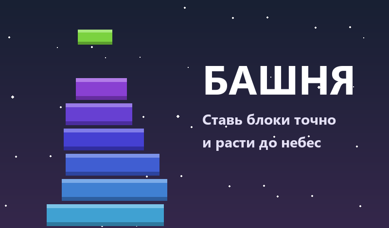
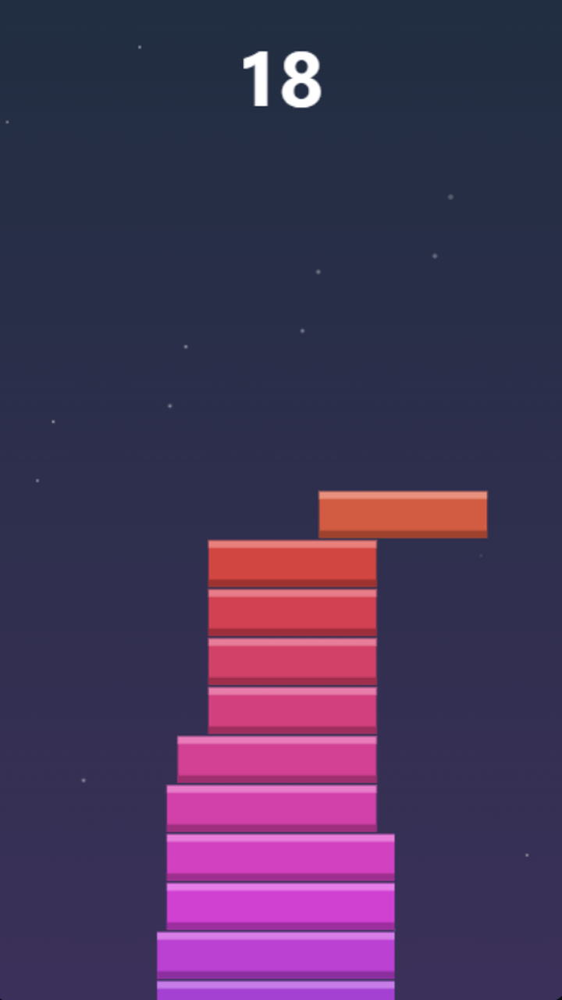
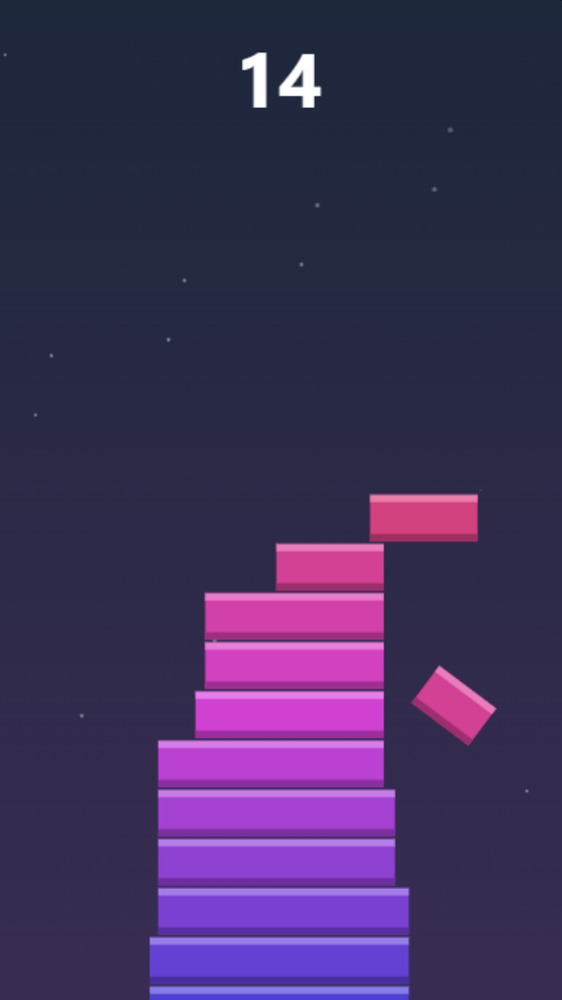
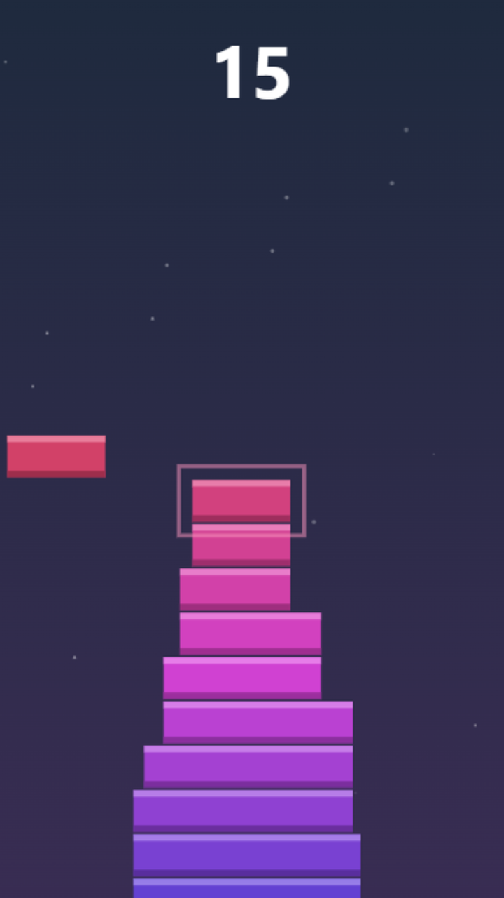
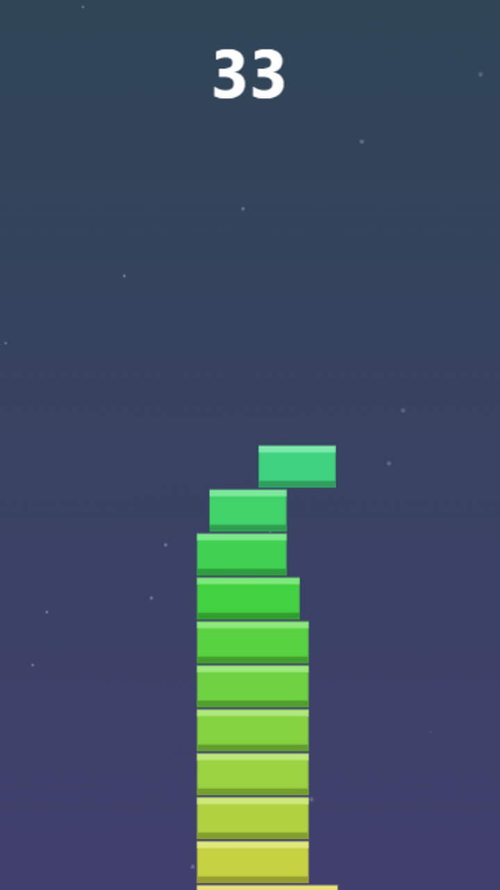

<div align="center">



# Башня

**Гиперказуальная аркада для Яндекс Игр: ставь блоки ровно, нависающее отрезается.**

  

</div>

<table>
<tr>
<td align="center" valign="top"></td>
<td align="center" valign="top"></td>
<td align="center" valign="top"></td>
<td align="center" valign="top"></td>
</tr>
</table>

<!-- header:end -->
Гиперказуальная аркада: блоки едут влево-вправо, тап ставит блок, нависающая часть
отрезается. Промах = конец. Цикл ~40 секунд.

## Запуск локально

```
python -m http.server 8123 --directory stack-tower
```

Открыть http://localhost:8123

Локально настоящий SDK не грузится — платформа отдаёт `/sdk.js` только со своего
домена. `ysdk.js` это детектит и подставляет заглушку, которая логирует вызовы
и мгновенно «показывает» рекламу. Игровой цикл отлаживается без деплоя.

## Где встроена монетизация

| Момент | Формат | Почему здесь |
|---|---|---|
| Кнопка «Продолжить» после смерти | rewarded video | Игрок сам выбирает смотреть. Частота платформой не ограничена. Даётся один раз за забег — иначе забег бесконечен и обесценивается |
| Кнопка «Заново» | fullscreen (interstitial) | Показ вне геймплея. Частоту режет сама платформа, поэтому вызывать можно на каждом рестарте |

Sticky-баннер пока не подключён — стоит добавить после первых метрик.

## Сборка и промо

```
python tools/build.py       # -> dist/stack-tower.zip (index.html в корне, с проверками)
python tools/make_promo.py  # -> promo/icon-512.png, promo/cover-800x470.png
```

Тексты полей заявки — в [promo/card.md](promo/card.md).

## Чек-лист перед загрузкой

- [x] SDK подключён (обязателен для модерации даже без монетизации)
- [x] `index.html` в корне архива
- [x] Нет пробелов и кириллицы в именах файлов
- [x] Адаптив: игра масштабируется под любой экран через ResizeObserver
- [x] Пауза и `GameplayAPI.stop()` при сворачивании вкладки
- [x] `LoadingAPI.ready()` после первой отрисовки
- [x] Реклама только через SDK, без внешних сетей и своих RTB-блоков
- [x] Размер сильно меньше лимита в 100 МБ
- [x] Название в игре и в карточке — оба «БАШНЯ»
- [x] Иконка 512×512 и обложка 800×470, обе не скриншоты из игры
- [ ] Скриншоты 16:9 — снять из реальной игры

## Что дальше

1. **Промо-материалы.** Иконка и скриншоты решают до половины успеха — алгоритм
   выдачи ранжирует в том числе по эффективности привлечения из карточки.
2. **Загрузка в консоль**, модерация 3–5 рабочих дней.
3. **Смотреть метрики**, а не доход. На первой игре важны удержание и
   возвращаемость: именно они кормят алгоритм. Порог выплаты — 3000 ₽.
4. **Портфель.** Одна игра статистически не окупается. Деньги делает несколько
   игр плюс попадание в алгоритм.

## Файлы

- `index.html` — разметка, кнопки настоящим DOM (не рисованные на канвасе,
  чтобы гарантированно тапались и не обрезались)
- `game.js` — игровой цикл, рендер, состояние
- `ysdk.js` — обёртка над SDK с локальной заглушкой
